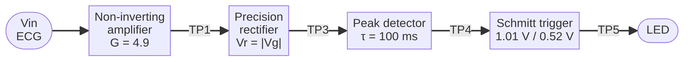
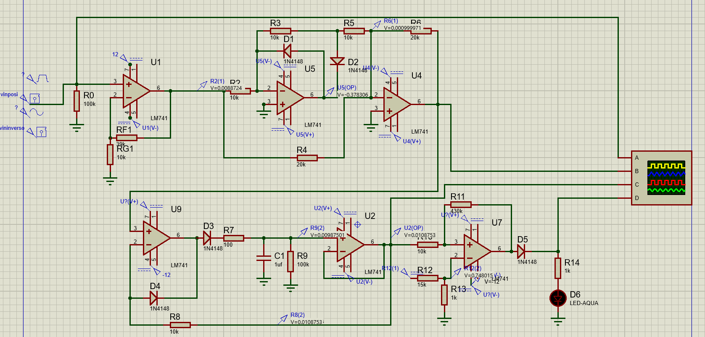
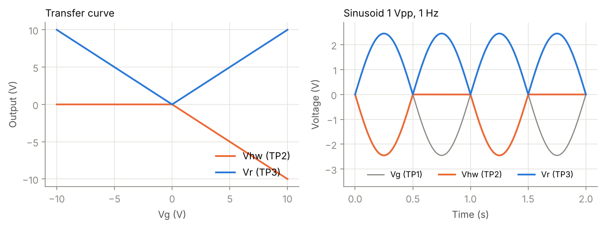
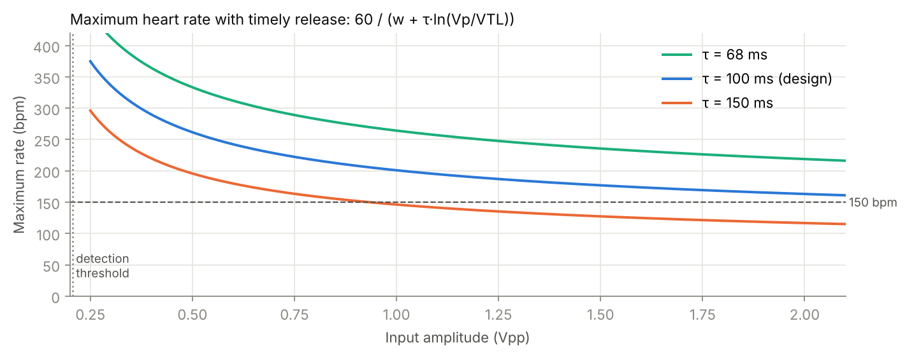
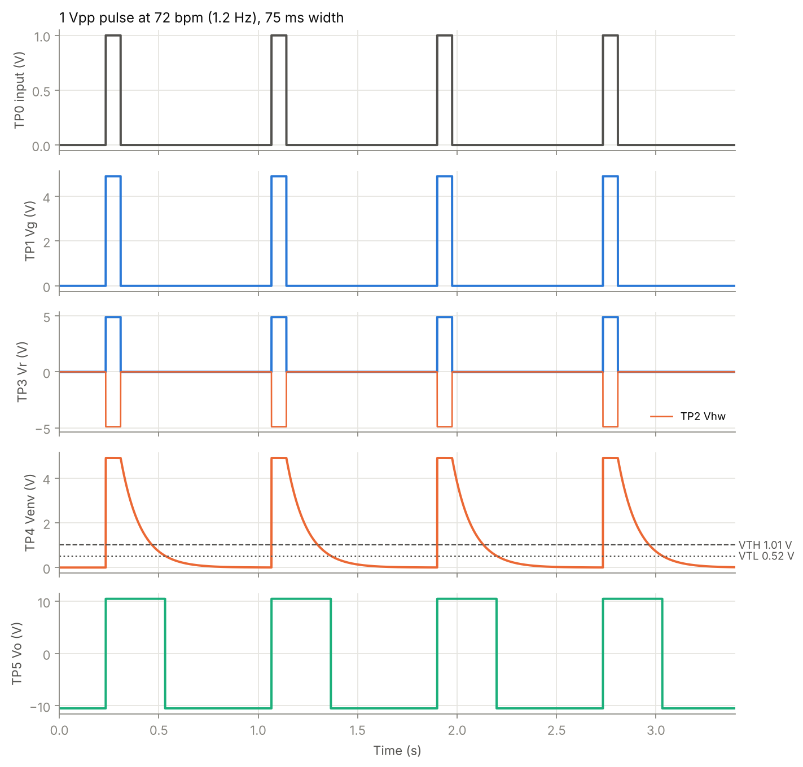
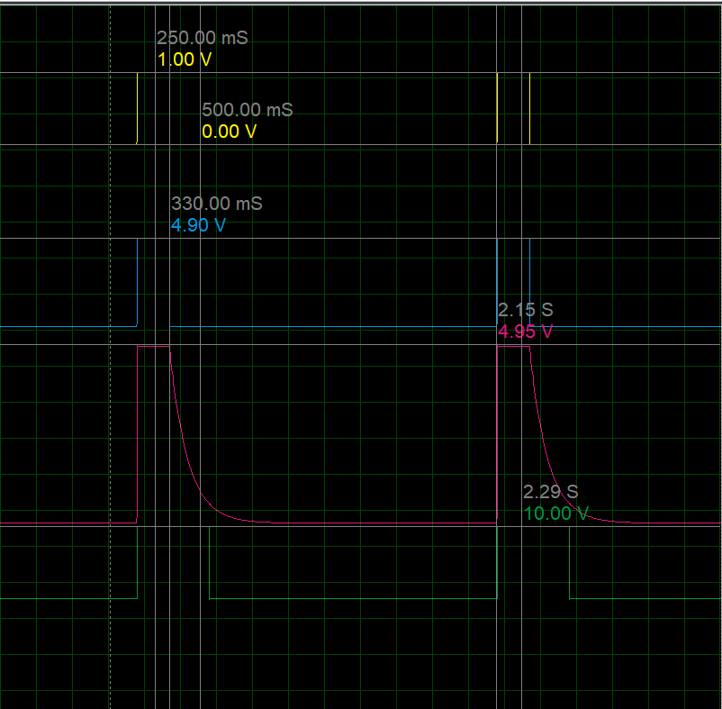
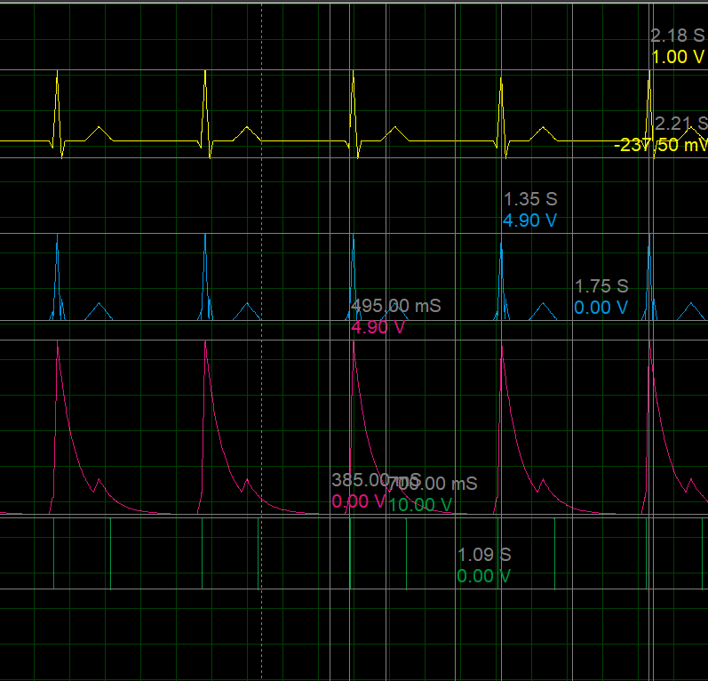
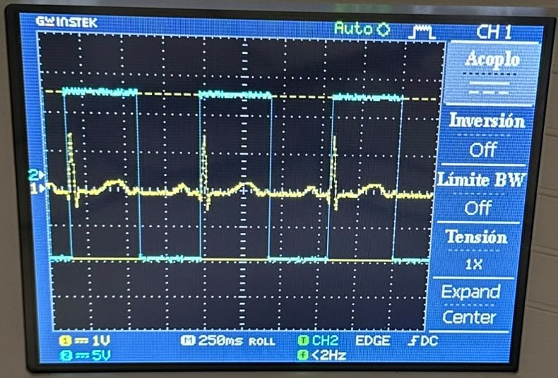
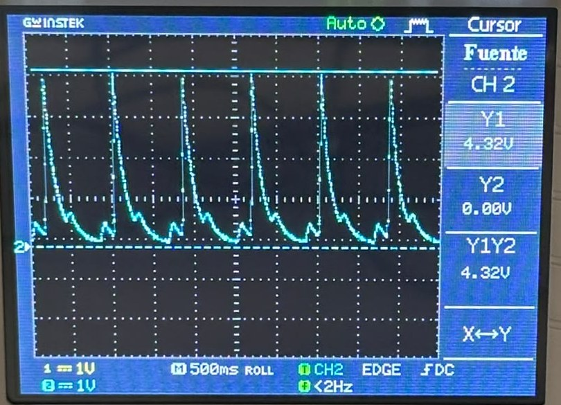
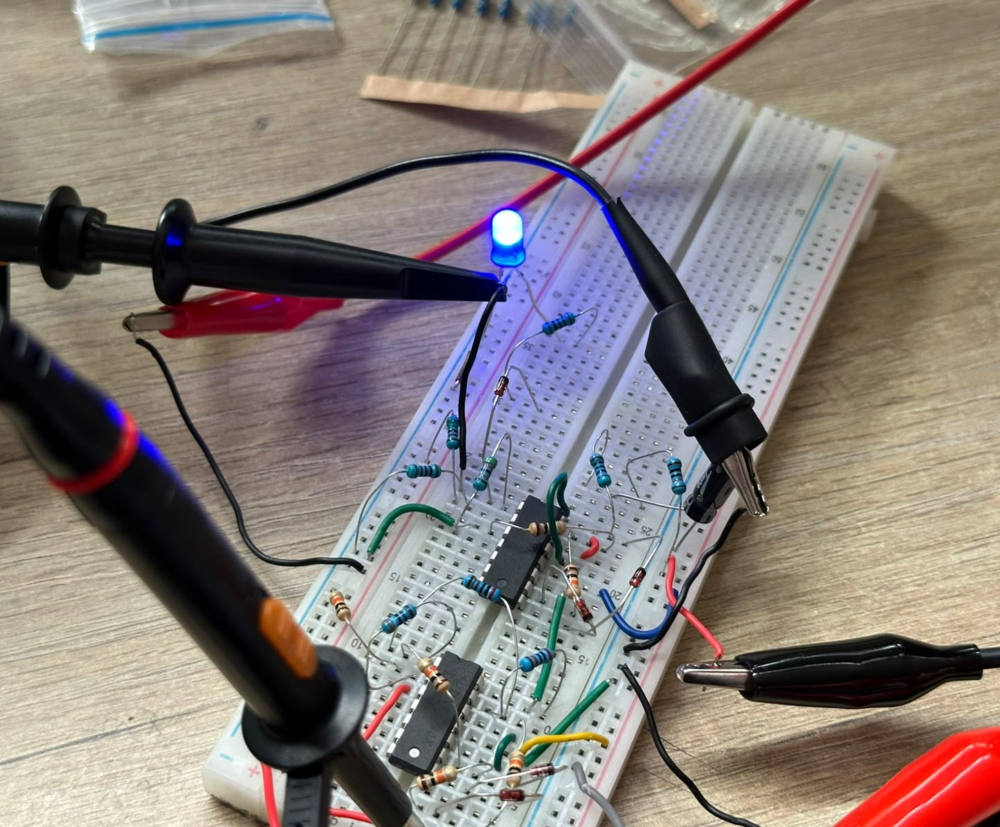

# ECG Heartbeat Detector with Operational Amplifiers


An analog circuit, simulated and built in the lab, that detects every QRS complex of an ECG-like signal and outputs **one clean rectangular pulse per heartbeat**, regardless of the polarity of the R wave. It uses six operational amplifiers on ±12 V and three nonlinear blocks: a precision rectifier, a peak detector and a Schmitt trigger.

> Nonlinear Circuits Laboratory project, Electronic Engineering, Universidad de Ibagué (Colombia).
> Instructor: Eng. Rodolfo José Gutiérrez González.

📄 **[Full report (PDF)](report/ECG_Heartbeat_Detector_Report.pdf)** · 📊 **[Slides (PDF)](presentation/ECG_Heartbeat_Detector_Slides.pdf)**

---

## Problem statement

Design and implement an op-amp-based heartbeat detector powered from ±12 V, able to identify every QRS complex of an ideal 0.5 to 2 Vpp ECG-like signal regardless of its polarity or waveform type, delivering one clean rectangular pulse per beat over a range of 40 to 150 beats per minute.

## Block diagram



## Circuit



| Stage | Op-amps | Function | Key values |
|---|---|---|---|
| 1. Non-inverting amplifier | U1 | Brings the signal to a useful range without saturating | Rf1 = 39 kΩ, Rg1 = 10 kΩ → **G = 4.9** |
| 2. Full-wave rectifier | U2 + U3 | Removes the dependence on polarity | Half-wave + summer → **Vr = \|Vg\|** |
| 3. Peak detector | U4 + U5 | Merges the QRS lobes into a single event | R9 = 100 kΩ, C1 = 1 µF → **τ = 100 ms** |
| 4. Schmitt trigger | U6 | Turns the envelope into a clean pulse | k = 10k/430k, Vref = 0.75 V → **VTH = 1.01 V, VTL = 0.52 V** |
| 5. Indicator | — | Shows every beat | R14 = 1 kΩ → **I_LED ≈ 7.8 mA** |

## Design equations

- **Gain** (saturation limit): $G \le V_{sat}/V_{in,max} = 10.5/2 = 5.25$ → chosen $G = 1 + R_{f1}/R_{g1} = 4.9$
- **Rectifier + summer**: $V_r = -(V_g + 2V_{hw}) = |V_g|$
- **Schmitt thresholds**: $V_{TH,TL} = V_{ref}(1+k) \pm V_{sat}\,k$, with $k = R_{10}/R_{11}$
- **Maximum heart rate**: $HR_{max} = \dfrac{60}{w + \tau \ln(V_p/V_{TL})}$ → 262 / 201 / 163 bpm for 0.5 / 1 / 2 Vpp

| Rectifier transfer curve | Maximum heart rate vs. amplitude |
|---|---|
|  |  |

## Simulation results

Response of every stage to a QRS-like pulse (behavioral simulation):



| Measurement (Proteus, 1 V pulse at 0.5 Hz) | Calculated | Simulated |
|---|---|---|
| Vr peak | 4.90 V | 4.90 V |
| Output pulse width | 405 ms | 400 ms |
| Maximum error | — | ≤ 1.6 % |

- Detects **every beat from 40 to 150 bpm** with both positive and negative R waves.
- With 2 Vpp it starts failing above ~163 bpm, exactly as the $HR_{max}$ equation predicts.
- With a sine wave it gives **2 pulses per cycle**, one per half-cycle, as expected from a full-wave rectifier.

| Test pulse in Proteus | Synthetic heartbeat in Proteus |
|---|---|
|  |  |

## Lab results

Built on a breadboard with **two LM324N** on ±12 V and tested with the built-in **CARDIAC** waveform (P, QRS and T waves) of an **Agilent 33120A** generator at 1.2 Hz (72 bpm), measured with a GW Instek GDS-1102A-U oscilloscope.


*Cardiac input (yellow) and Schmitt trigger output (blue): one rectangular pulse per QRS, with no false triggers from the T wave.*

| Peak detector envelope (TP4) | Breadboard with the LED on |
|---|---|
|  |  |

| Measurement | Design / Proteus | Lab |
|---|---|---|
| Vr peak (TP3), 1 Vpp input | — | 4.23 V |
| Venv peak (TP4) | — | 4.32 V |
| Output high level | 10.5 V (assumed) | 11.1 V |
| VTH / VTL | 1.01 / 0.52 V | 1.03 / 0.51 V (recalculated with 11.1 V) |
| Output frequency (1.2 Hz input) | 1.2 Hz | 1.199 Hz |
| Largest amplitude with correct detection | 2 Vpp (design) | **4 Vpp** |

- **One pulse per beat** with a realistic cardiac waveform, with no false triggers from the T wave.
- With **4 Vpp at 1.2 Hz**, twice the design maximum, the circuit still detected every beat: op-amp saturation clamps the envelope at ~11 V and bounds the discharge time. The low time between beats dropped to 78 ms, so the design is close to its limit there.
- With a sine wave, the rectifier outputs a clean full wave whose valleys reach exactly 0 V (no dead zone). The envelope does not have time to fall below VTL between half-cycles, as the simulation predicted.

## Repository layout

```
├── report/         LaTeX report (main.tex, esquema.tex, figures/) and compiled PDF
├── simulation/     Python behavioral simulation (sim.py)
├── proteus/        Synthetic heartbeat signals for the Proteus File generator
├── presentation/   Presentation slides (PPTX and PDF)
└── docs/img/       Images used in this README
```

## How to reproduce

**Python simulation**
```bash
cd simulation
pip install -r requirements.txt
python sim.py        # writes the 7 figures to simulation/fig/
```

**LaTeX report:** compile `report/main.tex` with pdflatex (twice, for the table of contents), or upload the `report/` and `simulation/` folders to Overleaf.

**Proteus:** load `proteus/ecg_beat_positive.txt` or `ecg_beat_inverted.txt` into a *File* generator connected to the input.

> The handwritten calculation sheets in the report and the oscilloscope menus in the lab photos are in Spanish. A Spanish version of this project is available at [Brahiam18/detector-latido-ecg](https://github.com/Brahiam18/detector-latido-ecg).

## Author

**Brahiam Alberto Campiño Romero**, Electronic Engineering student, Universidad de Ibagué.
